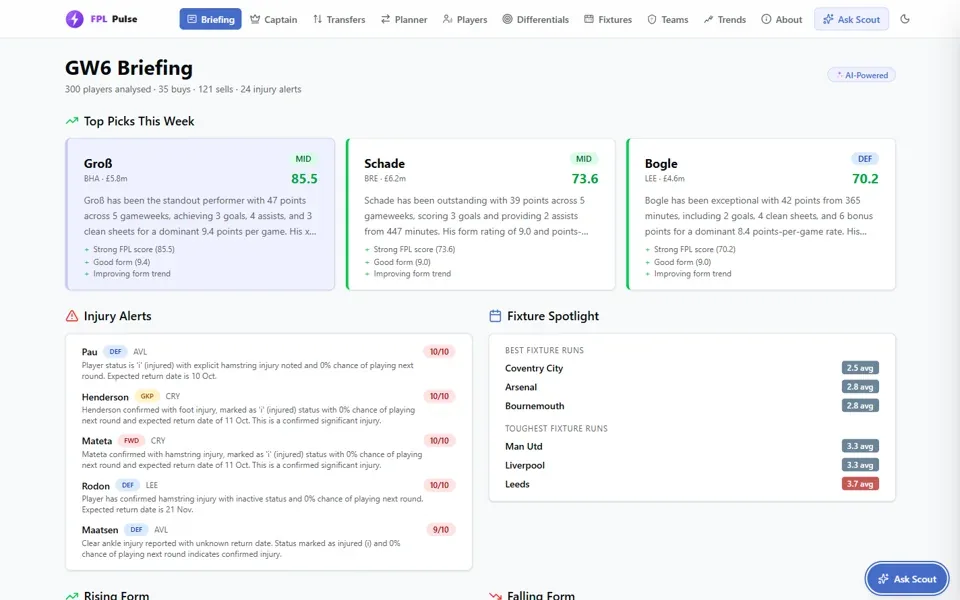
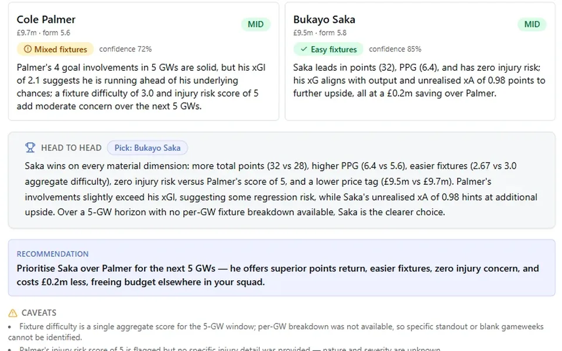
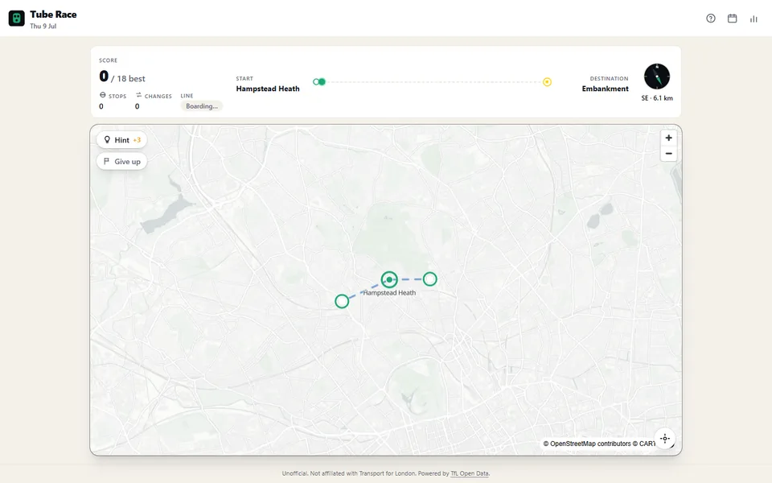

## Hi, I'm Issei

Data engineer by trade. I design and build LLM-based systems, and I'm always looking for better ways to work with AI, for myself and the people around me. The long version lives at [isseikuzuki.co.uk](https://isseikuzuki.co.uk).

<table>
  <tr>
    <td width="33%" valign="top">
      
      
<b>FPL Pulse</b> A weekly LLM enrichment pipeline for Fantasy Premier League, live on AWS.

      
<a href="https://github.com/ikuzuki/fpl-platform">Code</a> · <a href="https://fpl.isseikuzuki.co.uk/">Live</a> · <a href="https://isseikuzuki.co.uk/projects/fpl-pulse/">Write-up</a>

    </td>
    <td width="33%" valign="top">
      
      
<b>Scout Agent</b> A LangGraph agent that plans, fetches and reasons about transfers.

      
<a href="https://github.com/ikuzuki/fpl-platform/tree/main/services/agent">Code</a> · <a href="https://fpl.isseikuzuki.co.uk/chat">Live</a> · <a href="https://isseikuzuki.co.uk/projects/scout-agent/">Write-up</a>

    </td>
    <td width="33%" valign="top">
      
      
<b>Tube Race</b> A daily fog-of-war navigation game on the London Underground.

      
<a href="https://github.com/ikuzuki/tube-race">Code</a> · <a href="https://tube-race.isseikuzuki.co.uk/">Play</a> · <a href="https://isseikuzuki.co.uk/projects/tube-race/">Write-up</a>

    </td>
  </tr>
</table>

Also here: [knowledge-mcp](https://github.com/ikuzuki/knowledge-mcp), the hybrid retrieval server I built for my notes and then [deleted in favour of grep](https://isseikuzuki.co.uk/writing/vault-without-embeddings/), and the [source for the site](https://github.com/ikuzuki/website).

### Recent writing

<!-- writing:start -->
- [The bottleneck moved to verification](https://isseikuzuki.co.uk/writing/the-bottleneck-moved-to-verification/) · 16 Sep 2026
- [Directing a game I couldn't have written](https://isseikuzuki.co.uk/writing/a-game-in-a-language-i-dont-write/) · 19 Aug 2026
- [The agent wants one big table](https://isseikuzuki.co.uk/writing/obt-for-llm-agents/) · 09 Jul 2026
- [A year of AI coding at team scale](https://isseikuzuki.co.uk/writing/cursor-to-claude-code-migration/) · 01 Jul 2026
- [Evals, after putting them off](https://isseikuzuki.co.uk/writing/agent-eval-baseline/) · 27 May 2026
<!-- writing:end -->

Everything else is at [isseikuzuki.co.uk/writing](https://isseikuzuki.co.uk/writing/) ([RSS](https://isseikuzuki.co.uk/rss.xml)). I'm also on [LinkedIn](https://www.linkedin.com/in/issei-kuzuki-ab850722b/).
